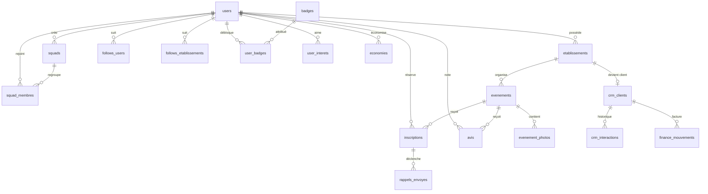

# Bases de données

Outsee utilise deux bases, chacune pour ce qu'elle fait le mieux :

| | MariaDB (relationnel) | MongoDB (NoSQL, documents) |
| --- | --- | --- |
| Contenu | Comptes, établissements, soirées, réservations, squads, CRM, finances | Journal d'activité |
| Accès | Doctrine ORM (`src/Entity`) | Doctrine MongoDB ODM (`src/Document`) |
| Pourquoi | Données liées entre elles, contraintes d'intégrité, transactions | Données qui ne font que grossir, sans jointure, au contenu variable |

## 1. MariaDB : le modèle métier

### Modèle conceptuel



25 tables, toutes en InnoDB et utf8mb4 (`config/packages/doctrine.yaml`) :

| Domaine | Tables |
| --- | --- |
| Comptes | `users`, `user_interets`, `password_resets` |
| Sorties | `etablissements`, `etablissement_photos`, `evenements`, `inscriptions`, `economies`, `avis`, `evenement_photos`, `evenement_photo_signalements`, `rappels_envoyes` |
| Social | `follows_users`, `follows_etablissements`, `user_blocks`, `user_reports`, `invitations`, `squads`, `squad_membres` |
| Gamification | `badges`, `user_badges` |
| Back-office | `crm_clients`, `crm_interactions`, `finance_mouvements`, `liste_attente` |

Les noms de tables reprennent ceux de l'ancienne version, pour pouvoir y importer les données existantes.

### Règles garanties par la base

Ces règles ne dépendent pas du code PHP : la base refuse elle-même une donnée incohérente.

| Règle | Mécanisme |
| --- | --- |
| Une adresse e-mail par compte | `UNIQUE (email)` |
| Une seule réservation par étudiant et par soirée | `UNIQUE (user_id, evenement_id)` |
| Un QR code ne peut pas exister deux fois | `UNIQUE (qr_code)` |
| Un seul avis par étudiant et par soirée | `UNIQUE (user_id, evenement_id)` |
| Pas de doublon dans une squad, un abonnement, une invitation | clés uniques ou clés primaires composées |
| Un rappel n'est jamais envoyé deux fois | clé primaire `(inscription_id, type)` |
| Supprimer une soirée supprime ses réservations | `ON DELETE CASCADE` |
| Supprimer un compte du back-office ne supprime pas l'historique | `ON DELETE SET NULL` |

Les valeurs fermées (statut d'une réservation, type de lieu, étape du pipeline…) sont des **enums PHP** (`src/Enum`), stockées en texte. Ajouter une valeur ne demande donc pas de modifier une colonne `ENUM` en base.

### Concurrence : la dernière place

Deux étudiants qui réservent la dernière place au même moment ne doivent pas passer tous les deux. `Service\Reservation` ouvre une transaction et pose un verrou sur la ligne de l'événement (`SELECT … FOR UPDATE`, via `LockMode::PESSIMISTIC_WRITE`). Le second attend que le premier ait fini, puis compte les places à nouveau.

### Index

Chaque index correspond à une requête réelle de l'application :

| Index | Requête servie |
| --- | --- |
| `evenements (date_heure)` | les soirées à venir, triées par date |
| `evenements (etablissement_id, date_heure)` | les soirées d'un établissement |
| `evenements (is_sponsorise, sponsor_jusqu_au)` | les soirées mises en avant en tête du fil |
| `inscriptions (evenement_id, statut)` | le nombre de places prises |
| `inscriptions (user_id, statut, created_at)` | les pass d'un étudiant |
| `user_interets (interet, user_id)` | trouver les étudiants qui partagent un centre d'intérêt |
| `follows_users (follower_id, statut, followed_id)` | les abonnements acceptés d'un étudiant |
| `crm_interactions (prochaine_action_le, fait)` | les relances du jour |

### Migrations

Le schéma est versionné avec Doctrine Migrations (`migrations/`). La première migration crée les 25 tables et insère le catalogue des badges, qui est une donnée de référence et non une donnée de démonstration.

```bash
php bin/console doctrine:migrations:migrate     # applique les migrations en attente
php bin/console doctrine:schema:validate        # vérifie que les entités et la base correspondent
```

La CI vérifie à chaque push que les migrations s'appliquent sur une base vide et que le résultat correspond aux entités.

## 2. MongoDB : le journal d'activité

### Ce qui y est stocké

Chaque action importante laisse un document dans la collection `journal_activite` :

```json
{
  "_id": ObjectId("…"),
  "action": "reservation",
  "utilisateurId": 12,
  "details": { "evenement": 42 },
  "ip": "86.245.17.0",
  "creeLe": ISODate("2026-11-04T19:42:00Z")
}
```

Actions enregistrées : connexion, création de compte, réservation, annulation, entrée validée, squad rejointe, avis déposé, soirée publiée, suppression de compte (`Service\Journal`).

### Pourquoi MongoDB plutôt qu'une table

- **Volume** : le journal grossit à chaque clic, bien plus vite que les données métier. Le sortir de MariaDB évite d'alourdir les sauvegardes et les requêtes du site.
- **Forme libre** : une réservation porte un identifiant de soirée, un avis porte une note, une connexion ne porte rien. Un document accepte ces différences sans colonnes vides.
- **Pas de jointure** : on ne lit le journal que par utilisateur ou par période. Le modèle document suffit.
- **Expiration automatique** : un index TTL sur `creeLe` supprime les entrées de plus d'un an, sans tâche planifiée. Avec l'adresse IP tronquée, cela répond au principe de minimisation du RGPD.

### Index

| Index | Usage |
| --- | --- |
| `{ utilisateurId: 1, creeLe: -1 }` | « activité récente » sur le profil |
| `{ action: 1, creeLe: -1 }` | statistiques par type d'action |
| `{ creeLe: 1 }` avec `expireAfterSeconds: 31536000` | suppression automatique après un an (TTL) |

```bash
php bin/console doctrine:mongodb:schema:create   # crée la collection et ses index
```

### Agrégation

Le tableau de bord admin et la commande `app:statistiques` comptent les actions par jour. Le calcul est fait par MongoDB, avec un pipeline d'agrégation (`EntreeJournalRepository::activiteParJour`) :

```
$match  { creeLe ≥ il y a 30 jours }
$group  { _id: { jour, action }, total: { $sum: 1 } }
$sort   { _id.jour: 1 }
```

### Une panne MongoDB ne bloque rien

Le journal est secondaire : si MongoDB ne répond pas, l'erreur est écrite dans les logs et l'action de l'utilisateur continue (`Service\Journal::enregistrer`). Une réservation ne doit jamais échouer à cause d'une statistique.

## Vérifier les deux bases

```bash
docker compose exec -u www-data app php bin/console doctrine:schema:validate
docker compose exec mongo mongosh outsee --eval "db.journal_activite.getIndexes()"
docker compose exec -u www-data app php bin/console app:statistiques 30
```
